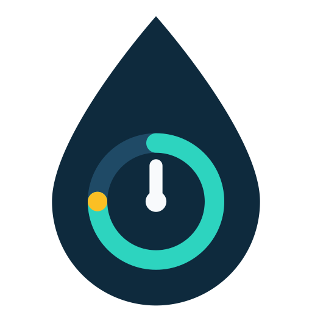
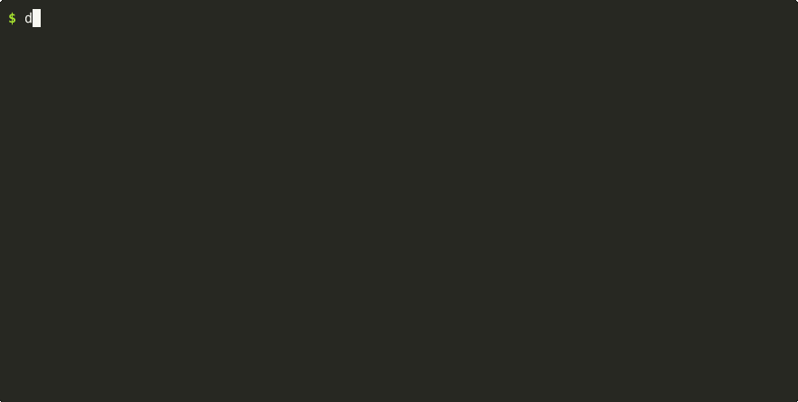

<p align="center"><picture><source media="(prefers-color-scheme: dark)" srcset="assets/logo-dark-512.png"></picture></p>

<h1 align="center">dofleet</h1>

<!-- mcp-name: io.github.aimanmalib/dofleet -->

<p align="center"><a href="https://github.com/aimanmalib/dofleet/actions/workflows/ci.yml"></a> <a href="https://pypi.org/project/dofleet/"></a> <a href="https://registry.modelcontextprotocol.io/v0/servers?search=io.github.aimanmalib/dofleet"></a> <a href="https://github.com/aimanmalib/dofleet/blob/main/LICENSE"></a></p>

<p align="center"><b>Disposable DigitalOcean droplets that delete themselves.</b> · <i>Droplet DigitalOcean pakai-buang yang memadam dirinya sendiri.</i><br>
<a href="https://pypi.org/project/dofleet/">PyPI</a> · <a href="#ai-agents-mcp">MCP server</a> · <a href="#the-reaper">reaper</a> · <a href="README.ms.md">Bahasa Melayu</a> · Built in Malaysia by <a href="https://aimanmalib.com">Aiman Malib</a> · <a href="https://sasateguh.com">Sasa Teguh</a></p>

Every droplet `dofleet` creates carries an expiry timer, and a reaper deletes it when the timer runs out, whether or not you remember. You see what a batch costs before you confirm, a month budget stops you before you pass it, and a sold-out size falls back to the next one in your preset instead of failing.

<p align="center"></p>

<sub>Recorded on a real account; waiting time is shortened. The droplet existed for 2 minutes and cost under a cent.</sub>

When the job ends, the droplet is gone and so is the bill.

## What it does

- **Timers and a reaper.** Each droplet is tagged with its expiry time. `dofleet reap` deletes expired ones from cron, or `dofleet install-reaper` runs it inside your DigitalOcean account as a scheduled Function, so nothing has to stay on.
- **Jobs.** `dofleet run` boots a droplet, copies a folder up, runs one command with live output, copies results back and deletes everything.
- **Money.** Cost before create, spend so far in `ls`, a `budget_usd` ceiling that blocks new droplets and (optionally) deletes running ones once the month's usage reaches it. GPU sizes cannot be created without a timer.
- **For AI agents.** `dofleet mcp` is an MCP server: Claude or another agent can borrow a droplet, run commands on it and give it back, inside limits you set. The agent never sees your token.
- **Fast boots.** `dofleet bake` snapshots a finished setup; `up --baked` boots from it in about 40 seconds instead of 2 to 3 minutes.
- **CI and previews.** A GitHub Action creates a droplet per job or pull request and deletes it after, with the timer as a backstop.
- **Sane setup.** Hardened Ubuntu (sudo user, firewall, fail2ban, key-only login), Docker, a remote desktop over RDP, or your own script. "Ready" means the setup finished, not only that port 22 opened.

## Why not just doctl?

[`doctl`](https://github.com/digitalocean/doctl) is the official CLI and covers the whole API. `dofleet` covers one job doctl leaves to you: short-lived machines that must not outlive their purpose.

| | doctl | dofleet |
| --- | --- | --- |
| Expiry timer + reaper (local cron or DigitalOcean Functions) | no | yes |
| Month budget that blocks creates and can stop the fleet | no | yes |
| One-command jobs: boot, copy, run, copy back, delete | no | yes |
| MCP server so AI agents can use droplets under a policy | no | yes |
| Cost before create, spend so far in `ls` | no | yes |
| Sold-out fallback across sizes and regions | no | yes |
| Waits until cloud-init has finished | no | yes |
| Volumes created, mounted and deleted with the droplet | no | yes |
| English and Bahasa Melayu output | English | both |
| Everything else in the DigitalOcean API | yes | no |

If you already use doctl, `dofleet` reads its token, so there is nothing to set up.

## Install

```bash
pipx install dofleet        # or: uv tool install dofleet
```

Python 3.11 or newer, plus `ssh` and `tar` for `run`. Until the first PyPI release: `pipx install git+https://github.com/aimanmalib/dofleet`.

## Token

Create a token at <https://cloud.digitalocean.com/account/api/tokens> (custom scopes, checked against [DigitalOcean's scope list](https://docs.digitalocean.com/reference/api/scopes/): full `droplet`, `block_storage`, `ssh_key`, `tag`, `snapshot` and `function`, plus `actions:read`, `account:read`, `billing:read`, `sizes:read`, `regions:read` and `image:read`; or simply read + write), then `export DIGITALOCEAN_TOKEN=dop_v1_...`, or keep using an existing `doctl auth init` login. `dofleet whoami` shows the account and where the token came from. More than one account: add profiles to the config and pass `-p <profile>`.

## Commands

| Command | What it does |
| --- | --- |
| `dofleet` | Numbered menu (in a terminal) |
| `dofleet up [preset] -n NAME -c N` | Create droplets. `--ttl 2h`, `--keep` (no timer), `-r sgp1`, `-s s-2vcpu-4gb`, `--volume 100`, `--baked`, `--var user=dev`, `--dry-run` |
| `dofleet run PRESET -- COMMAND` | One job on a fresh droplet. `--sync DIR`, `--pull PATH`, `--env K=V`, `--keep-on-fail` |
| `dofleet ls [-m]` | Droplets with IP, age, spend so far, price per month, time left |
| `dofleet extend NAME --ttl 4h` | Push the timer out (dofleet droplets only). `--keep` removes it |
| `dofleet reap [--yes] [--dry-run]` | Delete expired dofleet droplets, orphan volumes, and everything once over budget |
| `dofleet down NAME... [--yes]` | Delete by name, id or pattern (`'web-*'`), with their dofleet volumes. Patterns only match dofleet droplets unless `--any`; `--missing-ok` for cleanup jobs |
| `dofleet ssh NAME [-- command]` | SSH in as the user the preset created, or run one command |
| `dofleet bake NAME` / `dofleet snapshots` | Snapshot a finished droplet for fast boots / list those snapshots |
| `dofleet install-reaper` / `uninstall-reaper` | Reaper as a scheduled DigitalOcean Function. `--every 10m`, `--region`, `--notify-url`, `--token-env` |
| `dofleet mcp` | MCP server on stdio for AI agents |
| `dofleet cost` | Usage this month, budget left, what the fleet costs per day and month, orphan volumes |
| `dofleet sizes [-r REGION] [-f basic\|premium\|cpu\|memory\|gpu\|all]` | Sizes in stock, cheapest first |
| `dofleet restart NAME... [--hard]`, `presets`, `init`, `whoami` | Reboot, list presets, write a starter config, check the token |

Put `--json` before any command for machine-readable output and `--lang ms` or `--lang en` to pick the language (default follows `LANG`).

## The reaper

Pick one, or both (they do not get in each other's way):

```bash
dofleet install-reaper --every 10m            # runs in your DigitalOcean account, nothing local
```

```cron
*/10 * * * * DIGITALOCEAN_TOKEN=dop_v1_... /home/you/.local/bin/dofleet reap --yes >> ~/.dofleet-reap.log 2>&1
```

It only touches droplets tagged `dofleet` with a passed `dofleet-exp-<unix time>` tag (re-read just before deleting, in case someone extended it), their `dofleet` volumes, and `dofleet` volumes that have been attached to nothing for over an hour, counted from when a reaper first saw them detached, so a volume you just moved is safe. Droplets you made by hand are never touched. The Function version stores the token in your own Functions namespace; give it a separate token with `--token-env` if you prefer. `--notify-url` posts a short report to a Slack or Discord style webhook; locally, `notify_cmd` in the config runs any command.

## Budget

```toml
[defaults]
budget_usd = 50          # this month's DigitalOcean usage ceiling
budget_action = "reap"   # at the ceiling: "reap" deletes every dofleet droplet, "warn" only reports
```

`up`, `run` and agent requests refuse anything that would pass the ceiling: usage so far, plus what running droplets will still cost until their timers (or month end without one), plus the new batch. A sold-out fallback to a dearer size is checked again. The reaper applies `budget_action` once usage reaches it. Sizes listed in `require_ttl_for` (GPU by default) cannot be created without a timer.

## Jobs with `run`

```bash
dofleet run docker --sync . --pull dist -- bash -c "docker build -t app . && docker save app > dist/app.tar"
dofleet run scratch --volume 200 --env DATASET=2026-11 -- python3 crunch.py
```

The folder is copied to `~/work` on the droplet, the command runs there with its output streamed to your terminal, `--pull` paths come back to `dofleet-out/<name>/`, and the droplet and its volumes are deleted. The exit code is the command's. The droplet still has its timer, so if your laptop dies mid-job the reaper cleans up.

## AI agents (MCP)

Add dofleet to an MCP client, for example Claude Code's `.mcp.json`:

```json
{ "mcpServers": { "dofleet": { "command": "dofleet", "args": ["mcp"],
    "env": { "DIGITALOCEAN_TOKEN": "dop_v1_..." } } } }
```

The agent gets six tools: `dofleet_list`, `dofleet_create`, `dofleet_exec`, `dofleet_extend`, `dofleet_delete`, `dofleet_cost`. The policy is enforced by dofleet, not by the agent:

```toml
[mcp]
presets = ["tiny", "quick", "docker", "scratch"]   # what the agent may create
max_ttl = "4h"                                    # every agent droplet has a timer no longer than this
max_droplets = 3                                  # dofleet droplets at once
exec_timeout_s = 600
```

The agent only ever sees droplets it created itself (tagged `dofleet-mcp`); droplets you made with `dofleet up` are invisible to it, so it cannot run commands on, extend or delete them. `scope = "all"` widens that on purpose. The month budget applies to creates and extends, and a malformed request gets an error reply instead of stopping the server.

## GitHub Action

```yaml
name: preview
on: pull_request
jobs:
  preview:
    runs-on: ubuntu-latest
    steps:
      - uses: actions/checkout@v4
      - id: box
        uses: aimanmalib/dofleet@main
        with:
          token: ${{ secrets.DIGITALOCEAN_TOKEN }}
          preset: docker
          name: pr-${{ github.event.number }}
          ttl: 1d
      - run: echo "Preview at http://${{ steps.box.outputs.ip }}"
```

Delete it when the pull request closes with `command: down` and the same `name` (a droplet that is already gone is not an error); if that never runs, the timer does it. `command: run` takes `args` as one shell command, pipes and `&&` included. `config` takes a config file's contents (presets, budget). The runner's SSH key is added to the account automatically, inputs reach the shell only as environment variables, and a generated password is masked in the log and left out of the step outputs.

## Presets

| Preset | Size chain | Setup | Timer |
| --- | --- | --- | --- |
| `quick` | s-4vcpu-8gb, then the AMD and Intel twins, Singapore then Bangalore | harden | 8h |
| `tiny` | the cheapest sizes | harden | 2h |
| `docker` | s-2vcpu-4gb | docker | 1d |
| `scratch` | s-4vcpu-8gb + a 100 GB volume | harden | 6h |
| `desktop` | s-4vcpu-8gb | desktop (XFCE over RDP) | 8h |
| `gpu` | H100, then L40S, then RTX 4000 Ada (needs GPU access on the account) | harden | 2h |

Change them or add your own in `~/.config/dofleet/config.toml` (`dofleet init` writes a commented starter):

```toml
[presets.worker]
description = "Build worker"
regions = ["sgp1", "blr1"]
sizes = ["s-2vcpu-4gb", "s-2vcpu-4gb-amd"]
image = "ubuntu-24-04-x64"
cloud_init = "docker"      # a bundled template, or a path to your own script
ttl = "12h"
volumes = [50]
tags = ["ci"]
vars = { user = "dev" }
```

A key you set overrides the bundled one; everything else stays as shipped.

## Setup, keys, volumes, snapshots

- **Templates** are shell scripts cloud-init runs once: `harden` (sudo user with your keys, ufw, fail2ban, automatic security updates, key-only login), `docker` (harden + Docker Engine and compose), `desktop` (harden + XFCE over RDP; the password is generated and shown once). `#include <name>` composes them and `${user}`-style values come from `vars`. Your own file works the same way.
- **SSH keys.** If the account has none, dofleet adds your first local public key (named after its hash). With no key anywhere, DigitalOcean emails a root password and dofleet keeps root and password login on so you are not locked out. Each droplet gets its own known_hosts entry, because DigitalOcean reuses IP addresses.
- **Volumes** are formatted on first boot, mounted under `/mnt/<volume name>` (DigitalOcean shows the name with underscores), and deleted with the droplet by `down`, `run` and the reaper. Volumes you attached yourself are left alone.
- **Snapshots.** `dofleet bake NAME` keeps the newest `bake_keep` snapshots per preset and deletes older ones (snapshots bill per GB per month). `up --baked` skips the setup template, which already ran.

## Security model

- The token never leaves your machine, except into your own DigitalOcean Functions namespace if you install the Function reaper (`--token-env` lets that use a separate, narrower token).
- Destructive commands only act on droplets tagged `dofleet` unless you name a droplet exactly or pass `--any`; `extend` refuses other droplets, because a timer would hand them to the reaper.
- Files coming back from a droplet in `run` are unpacked with Python's tarfile `data` filter: no absolute paths, no `..`, no links pointing out, no device files.
- SSH is trust-on-first-use with one known_hosts file per droplet, since DigitalOcean reuses IP addresses.
- Known limit: the `desktop` password travels in the droplet's user data, which any process on that droplet can read from the metadata service. Change it after the first login if other people or containers share the box.

## Notes

- Costs shown are estimates from list prices. Backups, snapshots and bandwidth overage are not included. `dofleet cost` shows the real month-to-date figure.
- A create request is never retried after a server error, because DigitalOcean may already have made the droplets. Reads and deletes are retried with backoff.
- Volume deletion and some listings settle on DigitalOcean's side a minute or two after the call returns.
- What was tested against a live account, and what changed because of it, is in [02-DECISIONS.md](02-DECISIONS.md).

## Development

```bash
uv venv && uv pip install -e '.[dev]'
.venv/bin/pytest
```

The tests run against an in-memory fake of the DigitalOcean API and never touch a real account. User-facing text lives in `src/dofleet/locales/*.json`; a test fails if the English and Malay files drift apart.

## License

MIT. Made by [Aiman Malib](https://github.com/aimanmalib) at [Sasa Teguh](https://sasateguh.com).
