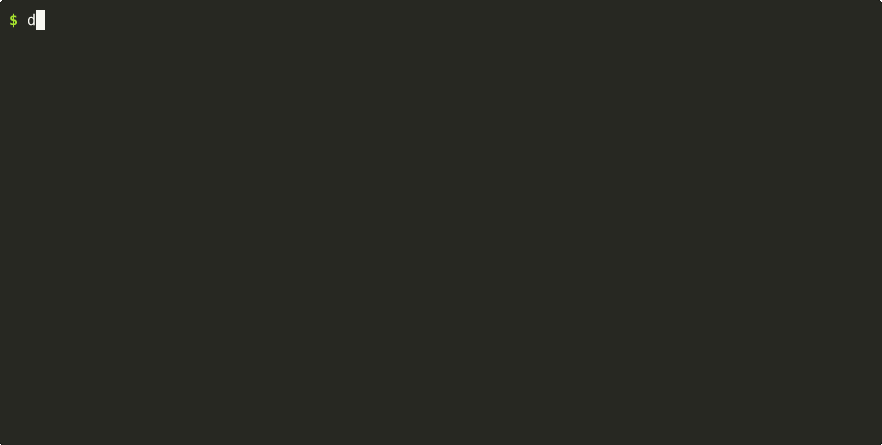

<p align="center">
  <picture>
    <source media="(prefers-color-scheme: dark)" srcset="https://raw.githubusercontent.com/aimanmalib/dofleet/main/assets/banner-dark.svg">
    
  </picture>
</p>

<p align="center"><a href="README.md">English</a></p>

Droplet DigitalOcean pakai-buang yang membersihkan dirinya sendiri.

Setiap droplet yang dicipta `dofleet` membawa pemasa tamat, dan reaper memadamnya bila masa tamat, sama ada anda ingat atau tidak. Anda nampak kos sebelum mengesahkan, bajet bulanan menghalang anda daripada melepasinya, dan saiz yang habis stok beralih ke pilihan seterusnya dalam pratetap.

<p align="center"></p>

Contoh dalam Bahasa Melayu:

```console
$ dofleet --lang ms run scratch --sync ./data --pull laporan.csv -- python3 proses.py
Pratetap      scratch
Lokasi        sgp1  s-4vcpu-8gb  (4 vCPU / 8 GB / 160 GB)
Volume        100 GB, dipadam bersama droplet
Pemasa tamat  6h00m
Bajet         baki $41.20 bulan ini
Hasil disalin ke dofleet-out/run
Kod keluar 0, 7.4 minit, kira-kira $0.01.
```

## Apa yang ia buat

- **Pemasa + reaper.** `dofleet reap` dari cron, atau `dofleet install-reaper` menjalankannya dalam akaun DigitalOcean anda sebagai Function berjadual, jadi tiada mesin anda perlu hidup.
- **Kerja satu arahan.** `dofleet run` hidupkan droplet, salin folder, jalankan arahan (output dipapar terus), salin hasil balik, padam semua.
- **Duit.** Kos sebelum cipta, belanja setakat ini dalam `ls`, dan siling `budget_usd`: `up` ditolak bila melepasi bajet, dan reaper boleh memadam semua droplet dofleet bila penggunaan bulan ini mencapainya. Saiz GPU wajib ada pemasa.
- **Untuk ejen AI.** `dofleet mcp` ialah pelayan MCP: Claude atau ejen lain boleh meminjam droplet, menjalankan arahan dan memulangkannya, dalam had yang anda tetapkan (`[mcp]` dalam config). Ejen tidak pernah nampak token anda.
- **Boot pantas.** `dofleet bake` mengambil snapshot persediaan yang siap; `up --baked` boot dalam kira-kira 40 saat, bukan 2 hingga 3 minit.
- **CI dan pratonton.** GitHub Action (`action.yml`) mencipta droplet untuk setiap kerja atau pull request dan memadamnya selepas itu.
- **Persediaan kemas.** Ubuntu dikeraskan, Docker, desktop jauh melalui RDP, atau skrip sendiri. "Sedia" bermaksud cloud-init sudah siap.

## Pasang dan token

```bash
pipx install dofleet
export DIGITALOCEAN_TOKEN=dop_v1_...
dofleet whoami
```

Jika anda sudah guna `doctl`, tokennya dibaca terus.

## Arahan utama

| Arahan | Fungsi |
| --- | --- |
| `dofleet up [pratetap]` | Cipta droplet (`--ttl`, `--volume`, `--baked`, `--dry-run`) |
| `dofleet run PRATETAP -- ARAHAN` | Satu kerja atas droplet baharu (`--sync`, `--pull`, `--env`) |
| `dofleet ls`, `cost` | Senarai dengan belanja dan masa tinggal; penggunaan bulan ini dan baki bajet |
| `dofleet extend`, `down`, `reap` | Lanjut pemasa, padam, padam yang tamat |
| `dofleet bake`, `install-reaper`, `mcp` | Snapshot, reaper dalam DigitalOcean Functions, pelayan MCP |

Senarai penuh, contoh config, GitHub Action dan butiran keselamatan ada dalam [README Inggeris](README.md). Tambah `--lang ms` untuk paparan Bahasa Melayu (lalai ikut `LANG`).

## Keselamatan

- `reap` dan reaper Function hanya menyentuh droplet bertag `dofleet`, dan membaca semula setiap droplet sebelum memadam. Corak dalam `down` (`'web-*'`) hanya padan droplet dofleet kecuali dengan `--any`; `extend` menolak droplet bukan dofleet.
- Ejen AI melalui MCP hanya nampak droplet yang ia cipta sendiri (tag `dofleet-mcp`), bukan droplet anda.
- Fail yang dibawa balik oleh `run` dibuka dengan penapis `data` tarfile: tiada laluan mutlak, `..` atau pautan keluar.
- Akaun tanpa kunci SSH: kunci awam tempatan anda ditambah. Tiada kunci langsung: log masuk root + kata laluan kekal supaya anda tidak terkunci.
- Arahan cipta tidak diulang selepas ralat pelayan, kerana DigitalOcean mungkin sudah mencipta droplet.

## Lesen

MIT
